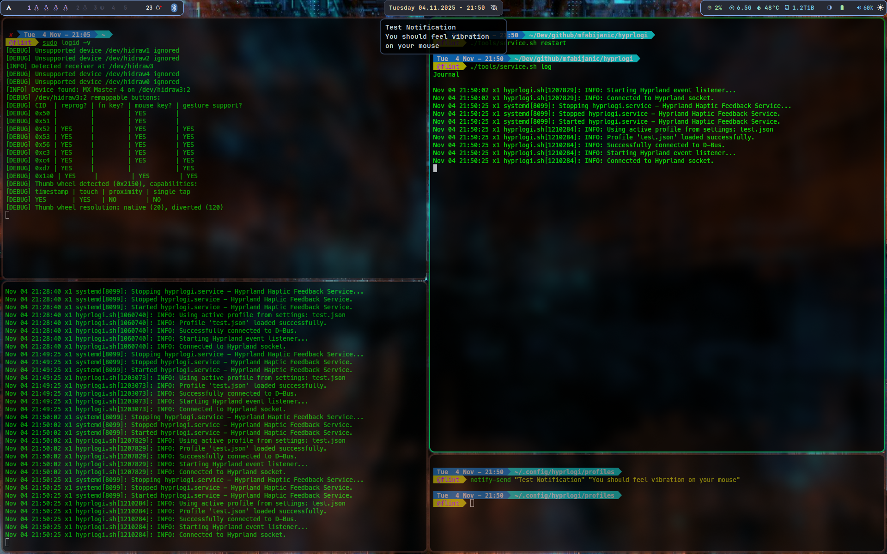

# HyprLogi - Haptic Feedback for Hyprland Events

HyprLogi is a Python-based utility that connects Hyprland's event system with Logitech devices supporting haptic feedback (like the MX Master 4). It allows you to trigger configurable haptic effects on your mouse for various window manager events, such as changing workspaces, opening applications, or switching focus.

This provides a more tactile and immersive desktop experience, giving you physical confirmation for your actions.

## Features

- **Event-Driven Haptics**: Trigger haptic feedback on any Hyprland event.
- **Highly Configurable**: Map events (and event arguments) to haptic waveforms in simple JSON profiles.
- **Works with OpenLogi, LogiOps, or no daemon at all**: see [Backends](#backends).
- **Robust**: reconnects when the mouse sleeps or Hyprland restarts, reloads its configuration on `SIGHUP`.
- **Omarchy integration**: a Setup > Haptics menu, system hooks and an Omarchy profile (see [Omarchy](#omarchy)).
- **Scriptable**: `hyprlogi play`, `profile set` and `pause` talk to the running daemon.
- **Lightweight**: no dependencies for the default backend.

---

## Backends

| Backend   | How it plays effects | Needs |
|-----------|----------------------|-------|
| `hidpp`   | Sends the HID++ `playWaveform` command (feature `0x19B0`) straight to the mouse's `/dev/hidrawN`. Runs side by side with [OpenLogi](https://openlogi.org/) (or Solaar, or nothing). | Write access to the Logitech hidraw node: OpenLogi's udev rule, or [`contrib/70-hyprlogi.rules`](contrib/70-hyprlogi.rules). |
| `logiops` | Calls `PlayEffect` on the patched `logid` over the system D-Bus. | The [kris7t/logiops `haptic-feedback`](https://github.com/kris7t/logiops/tree/haptic-feedback) fork, the D-Bus policy, and `pip install 'hyprlogi[logiops]'`. |
| `auto`    | `logiops` when the patched logid is running, otherwise `hidpp`. | |

OpenLogi does not (yet) expose haptics through `openlogi api`, so with OpenLogi HyprLogi talks to the mouse
directly. HID++ pairs replies to requests by *software id*: OpenLogi leases ids from 1 upwards, HyprLogi uses
15 by default (`hidpp.sw_id`), so the two never see each other's replies.

## Installation

```sh
git clone https://github.com/mfabijanic/hyprlogi.git
cd hyprlogi
./install.sh
```

The installer asks for a backend, installs the `hyprlogi` command with `uv` or `pipx`, writes the backend to
`settings.json` and enables the systemd user service. Manual installation:

```sh
uv tool install .                 # or: pipx install .
uv tool install '.[logiops]'      # with the logiops backend
```

### hidpp backend (OpenLogi / no daemon)

If OpenLogi is installed, nothing else is needed. Otherwise install the udev rule:
```sh
sudo cp contrib/70-hyprlogi.rules /etc/udev/rules.d/
sudo udevadm control --reload-rules && sudo udevadm trigger
```

### logiops backend

Build and install the `haptic-feedback` fork of `logid`:
```sh
git clone https://github.com/kris7t/logiops.git
cd logiops
git checkout haptic-feedback
mkdir build && cd build
cmake -DCMAKE_BUILD_TYPE=Release ..
make
sudo make install
sudo systemctl enable --now logid
```
Then allow D-Bus access from the hyprlogi directory: `sudo cp pizza.pixl.LogiOps.conf /etc/dbus-1/system.d/`.
An example `logid.cfg` for the MX Master 4 is included.

---

## Configuration

HyprLogi uses a profile-based system, with configurations stored in the XDG standard directory (`~/.config/hyprlogi`).

### Structure

-   `~/.config/hyprlogi/settings.json`: A simple file that points to the currently active profile.
-   `~/.config/hyprlogi/profiles/`: A directory containing all your haptic profiles.

The first time you run the script, it will automatically create this structure and copy some default profiles (`default.json`, `subtle.json`, etc.) into the `profiles` directory.

### Switching Profiles

You can switch profiles in two ways:

1.  **Edit `settings.json` (Permanent)**
    Change the `active_profile` value to the filename of the profile you want to use.
    ```json
    {
      "active_profile": "subtle.json"
    }
    ```
    Apply it with `systemctl --user reload hyprlogi` (no restart needed).

2.  **Use the `--profile` CLI flag (Temporary)**
    This is useful for testing a profile without changing your default setting.
    ```sh
    hyprlogi --profile subtle
    # You can omit the .json extension
    ```

### Creating a New Profile

1.  Copy an existing profile in `~/.config/hyprlogi/profiles/`, for example:
    ```sh
    cp ~/.config/hyprlogi/profiles/default.json ~/.config/hyprlogi/profiles/my-custom.json
    ```
2.  Edit `my-custom.json` to your liking. The format maps Hyprland event names to haptic effect IDs.
    ```json
    {
      "default_effect": null,
      "events": {
        "activewindowv2": 2,
        "workspace": 5,
        "openwindow": 10,
        "closewindow": 11,
        "fullscreen": 7,
        "openlayer": {
          "default": 1,
          "args": {
            "swaync-notification-window": 14
          }
        }
      }
    }
    ```
    Here `openlayer` plays effect 1 for any layer, and 14 for `openlayer>>swaync-notification-window`.
    - `default_effect`: (Optional) The effect ID for any unlisted event. `null` disables it.
    - `events`: A dictionary where the key is the **Hyprland event name**.
        - The value can be a direct **haptic effect ID** (an integer).
        - Or, for more granular control, the value can be an **object** with:
            - `"default"`: (Optional) The effect ID to use for this event if no specific argument matches.
            - `"args"`: A dictionary mapping specific **event arguments** (e.g., `"swaync-notification-window"`) to their respective **haptic effect IDs**.

### Settings

All keys of `~/.config/hyprlogi/settings.json` are optional except `active_profile`:

```json
{
  "active_profile": "default.json",
  "backend": "auto",
  "hidpp": { "device": "auto", "sw_id": 15, "ensure_enabled": false, "intensity": 60 },
  "cooldown_ms": 40
}
```

- `backend`: `auto`, `hidpp` or `logiops` (see [Backends](#backends)); `--backend` overrides it.
- `hidpp.device`: `auto`, a `/dev/hidrawN` path, or a device name such as `"MX Master 4"`.
- `hidpp.sw_id`: HID++ software id (1–15) used for requests.
- `hidpp.ensure_enabled`: turn the mouse's haptics on at `intensity` % if they are off. Off by default, so OpenLogi's setting is respected.
- `cooldown_ms`: one action emits several events (a workspace switch sends `workspace`, `activewindowv2`, `focusedmon`...). Only the first effect within this window is played.

### Effects

Effects are the mouse's built-in waveform ids. List the ones your mouse supports and try them:
```sh
hyprlogi waveforms     # MX Master 4: 0-14
hyprlogi test 1 4 5
```

### How to Discover Hyprland Events

To find the names of events you want to use, you can listen to the Hyprland socket directly using `socat`.

1.  Open a terminal and run:
    ```sh
    socat -U - UNIX-CONNECT:$XDG_RUNTIME_DIR/hypr/$HYPRLAND_INSTANCE_SIGNATURE/.socket2.sock
    ```
2.  Perform actions in Hyprland (change windows, open apps, etc.). The terminal will print the event names. The event name is the string before the `>>`.
    ```
    workspace>>1
    activewindowv2>>5c2d140
    openwindow>>5c2d140,1,kitty,
    ```
3.  Add these event names to your profile.

---

## Usage

```sh
hyprlogi              # run the daemon (same as 'hyprlogi daemon')
hyprlogi --debug      # show every event and effect
hyprlogi devices      # list Logitech HID++ devices and whether they have haptics
hyprlogi waveforms    # supported waveforms and haptic settings (hidpp)
hyprlogi test 1 4     # play effects directly on the device
hyprlogi play 1 4     # play effects through the running daemon (for scripts and hooks)
hyprlogi profile                # list profiles (* = active)
hyprlogi profile set subtle     # switch profile, the daemon picks it up immediately
hyprlogi pause | resume | toggle
hyprlogi status                 # daemon, profile, backend, device, paused
```

`play` reuses the daemon's connection to the mouse (over `$XDG_RUNTIME_DIR/hyprlogi/control.sock`) and plays
directly when no daemon runs. Pausing silences events and `play` alike, and lasts until `resume` or reboot.

From a source checkout without installing: `python3 hyprlogi.py ...` (or `./hyprlogi.sh`).

### Running as a Systemd User Service (Recommended)

`install.sh` does this for you. Manually:

```sh
cp systemd/hyprlogi.service ~/.config/systemd/user/
systemctl --user daemon-reload
systemctl --user enable --now hyprlogi.service
```

The unit runs `~/.local/bin/hyprlogi daemon`. Check it with:
```sh
systemctl --user status hyprlogi.service
journalctl --user -u hyprlogi.service -f
systemctl --user reload hyprlogi.service   # re-read settings and profile
```

## Omarchy

On [Omarchy](https://omarchy.org/) 4, `install.sh` runs `hyprlogi omarchy install`, which:

- switches to the `omarchy` profile (unless you already chose a profile other than `default`). It knows
  Omarchy's layers: a pulse for notifications (`openlayer>>omarchy-notifications`) and the Omarchy menu, and
  none for the OSD, which opens on every volume step.
- adds **Setup > Haptics** to the Omarchy menu (`~/.config/omarchy/extensions/omarchy-menu.jsonc`, between
  `// >>> hyprlogi` markers): pause, profile switching, a test, editing settings and restarting the service.
  Run `hyprlogi omarchy menu` after adding or removing profiles to refresh the list.
- installs Omarchy hooks: `battery-low` and `theme-set` play an effect through the daemon.

`hyprlogi omarchy install --no-hooks` skips the hooks, `hyprlogi omarchy uninstall` removes the menu and hooks.
The daemon is a systemd user service under `graphical-session.target`, which Omarchy's uwsm session starts;
there is nothing to add to `~/.config/hypr/autostart.lua`.

## Development

```sh
uv run --no-project --with pytest python -m pytest
```

## Acknowledgements

-   **[OpenLogi](https://github.com/AprilNEA/OpenLogi)** and **[Solaar](https://github.com/pwr-Solaar/Solaar)**: For reverse-engineering the HID++ haptic feedback feature (`0x19B0`).

-   **[vjeko2404](https://github.com/vjeko2404)**: For LogiOps Logitech MX4 Master configuration ([LogiOps Logitech MX4 Master configuration])(https://github.com/PixlOne/logiops/issues/520)
-   **Kristóf Marussy**: For the invaluable `logid` fork with haptic feedback support ([kris7t/logiops](https://github.com/kris7t/logiops/tree/haptic-feedback)).
-   **[davifochi](https://github.com/davifochi)**: For ([davifochi/logiops](https://github.com/davifochi/logiops/tree/haptic-feedback)).

## License

This project is licensed under the GNU General Public License v3.0. See the `LICENSE` file for details.
